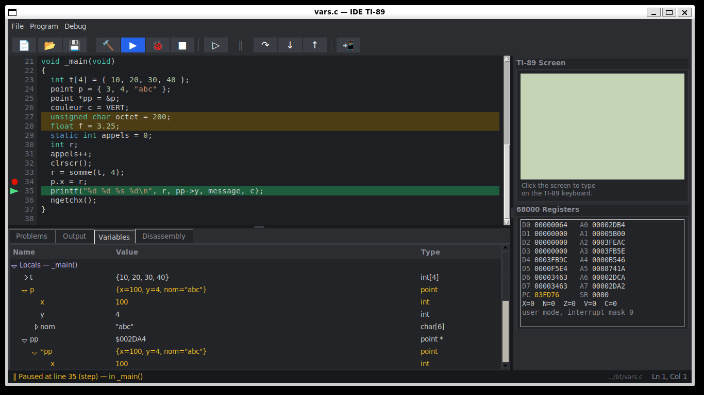
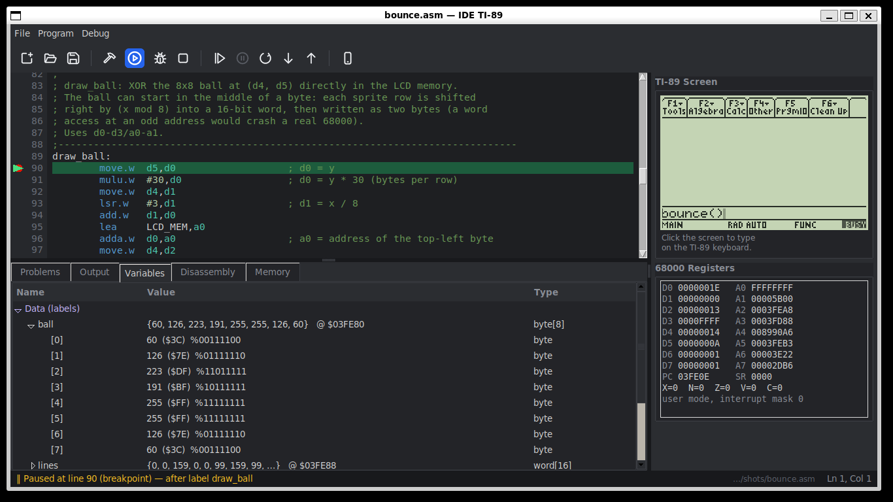
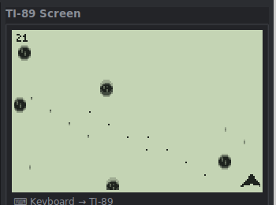

# TI-89 IDE

A small integrated development environment for the **TI-89 Titanium**, running on
Linux / WSL: write a program in **C** or **68000 assembly**, run it in a built-in
emulator, debug it at source level, and send it to the real calculator over USB.



## Features

- **Editor** with syntax highlighting for C, GNU as and A68k assembly, line numbers,
  auto-indent, breakpoints in the margin.
- **Build** with [GCC4TI](https://github.com/debrouxl/gcc4ti) (GCC 4.1.2, C99 mode),
  errors and warnings listed and highlighted in the code. Optimization level for
  Build / Run / Send: speed (`-O2`, default), size (`-Os`) or none (`-O0`), in
  *Program > Optimization* or by clicking the indicator in the status bar; Debug always
  builds with `-O0`.
- **Run** in an emulated TI-89 Titanium: only the calculator screen is shown; your PC
  keyboard types on the calculator (AZERTY or QWERTY, arrows can be held for games).
  Grayscale (4 levels) is rendered correctly.
- **Debugger**
  - breakpoints, Continue, Pause, Step Over, Step Into, Step Out;
  - 68000 registers in hex, unsigned / signed decimal or binary (changed values
    highlighted); click a register for its .b / .w / .l values, binary, ASCII, the
    nearest program label, or the SR flags bit by bit;
  - disassembly annotated with source lines;
  - **C variables** (locals, parameters, globals, statics) with their types: integers,
    chars, enums, TI floats, pointers, strings, arrays, structs;
  - **memory view** (hex dump, follow a register, edit RAM bytes);
  - assembly: step by instruction, step over `jsr`/`bsr` and AMS ROM calls; the
    Variables tab shows labelled data (`dc.b`/`dc.w`/`ds`, `.byte`/`.word`/`.asciz`...)
    read from memory, and the `equ` constants.
- **Send to the real TI-89 Titanium** over the direct USB cable (libticalcs, usbipd on WSL).
- Examples in `projets/exemples/`: graphics, grayscale, a rotating 3D cube and two small
  games.



## How it works

| Part | Location | Notes |
|---|---|---|
| IDE | `ide89/` | Python / tkinter |
| Emulator | `emu89/` | 68000 CPU: [Musashi](https://github.com/kstenerud/Musashi) (C, git submodule); memory map, I/O ports, flash, timers, keyboard and LCD in Python (`emu89/ti89emu/`), following the *TI hardware guide* by Romain Liévin |
| Debug info | `emu89/ti89emu/dbginfo.py`, `variables.py` | DWARF 2 from `tigcc -g` (.dbg files); A68k listings for `.asm` files |
| Loading programs | `emu89/ti89emu/stubs/loadvar.s` | a tiny 68000 loader calls AMS itself (`SymAdd`, `HeapAlloc`...) to create the program variable |

Programs are run from a snapshot of the emulated calculator taken once AMS has booted,
so every run starts from a clean state.

## Requirements

- Linux or WSL 2 (tested on Ubuntu 24.04 / WSL 2 with WSLg)
- `python3` with `tkinter`, `gcc`, `make`, `git`, `patch`, `bzip2`
- To send programs to a real calculator: the TI link libraries
  (`libticalcs2`, `libticables2`, `libtifiles2`, e.g. installed with the `tiemu` or `tilp2`
  packages) and, on WSL, [usbipd-win](https://github.com/dorssel/usbipd-win)
- **Your own TI-89 Titanium ROM image** (see below)

## Installation

### Ready-to-use Linux package

**[download ti89-ide-linux.tar.gz](https://github.com/JC-Toussaint/ti89-ide/releases/download/linux-v1.0/ti89-ide-linux.tar.gz)**
([release page](https://github.com/JC-Toussaint/ti89-ide/releases/tag/linux-v1.0)):
x86_64, glibc 2.38 or later (Ubuntu 24.04+, Debian 13+, Fedora 39+...). It contains the
IDE, the emulator and GCC4TI, with Python and Tk included:

```sh
tar -xzf ti89-ide-linux.tar.gz
cd ti89-ide-linux
./ti89-ide                  # after putting your ROM in ROM/ (see below)
```

The package is built with `scripts/package_linux.sh`.

### From the sources

```sh
git clone --recurse-submodules https://github.com/JC-Toussaint/ti89-ide.git
cd ti89-ide
scripts/setup.sh            # Python environment (pyelftools, Pillow), Musashi, C core
scripts/build_gcc4ti.sh     # builds the GCC4TI toolchain into ./gcc4ti (10-20 min)
```

### ROM image

The calculator operating system (AMS) is copyrighted by Texas Instruments and is
**not included**. Dump the ROM of your own calculator (for example with TiLP or TiEmu)
and save it as `ROM/ti89tv310.rom` (4 MB, AMS 3.10), or point the `TI89_ROM`
environment variable to it.

## Windows

A native Windows version is available as a zip package:
**[download ti89-ide-windows.zip](https://github.com/JC-Toussaint/ti89-ide/releases/download/windows-v1.0/ti89-ide-windows.zip)**
([release page](https://github.com/JC-Toussaint/ti89-ide/releases/tag/windows-v1.0)).
Unzip it, put your ROM in the
`ROM` folder, and start `ti89-ide.exe` (no Python, no WSL needed). It contains the IDE,
the emulator and a Windows build of GCC4TI whose output is identical, byte for byte, to
the Linux one.

Building the package from Linux / WSL (needs `mingw-w64` and Python 3 for Windows):

```sh
scripts/build_gcc4ti.sh             # Linux toolchain first (its headers and libraries are reused)
scripts/build_gcc4ti_windows.sh     # GCC4TI cross-built for Windows into ./gcc4ti-win
make -C emu89/core windows          # ti89core.dll
scripts/package_windows.sh          # dist-windows/ti89-ide-windows.zip
```

Notes: the Windows toolchain is 32-bit (GCC 4.1.2 crashes as a 64-bit Windows program);
sending to a real calculator on Windows uses TiLP for Windows and its USB driver.

## Usage

```sh
./run-ide.sh [program.c | program.s | program.asm]
```

| Action | Key |
|---|---|
| Build | F7 |
| Run in the emulator / Continue | F5 |
| Debug | F6 |
| Toggle breakpoint | F9 or click in the margin |
| Step Over / Into / Out | F10 / F11 / Shift+F11 |
| Stop | Shift+F5 |
| Send to the TI-89 (USB) | Ctrl+T |

Click the calculator screen to type on the TI-89 keyboard; click the editor to get the
keyboard back. Program names must follow TI-89 rules (8 characters max., not a
built-in command name such as `graph`).

### Sending to a real calculator from WSL

Once, with the calculator plugged in and turned on:

1. in an **administrator** PowerShell: `usbipd bind --hardware-id 0451:e004`
2. in WSL, allow your user to access the device:
   ```sh
   echo 'SUBSYSTEM=="usb", ATTR{idVendor}=="0451", ATTR{idProduct}=="e004", MODE="0666"' \
     | sudo tee /etc/udev/rules.d/70-ti89titanium.rules
   sudo udevadm control --reload-rules && sudo udevadm trigger
   ```

The IDE then attaches the calculator to WSL by itself (`usbipd attach`) when you send a program.

## Basic89 (prototype)

**Basic89** is a structured BASIC in the spirit of QuickBASIC, made for the TI-89 Titanium.
A `.b89` program is translated to C (`program.b89.c`) and compiled by GCC4TI: it runs at
the speed of a C program. Every generated statement carries a `#line` directive, so the
error messages **and the debugger** (breakpoints, stepping, variables) work on the lines of
the Basic program. *File > New Basic89 Program* creates a small example; F5 runs, F6 debugs.
Examples: `projets/exemples/balls.b89`, `projets/exemples/orbit.b89` (FIXED numbers, grayscale),
`projets/exemples/guess.b89` (STRING, INPUT), `projets/exemples/catch.b89` (sprites, sound, saved best score), `projets/exemples/maze.b89` (tile map, scrolling),
`projets/exemples/cube2.b89` (the 3D cube of `cube.c`).

```basic
DIM x AS INTEGER = 72
SCREEN BUFFERED
DO
  IF KEYDOWN(KEY_LEFT) AND x > 0 THEN x -= 2
  IF KEYDOWN(KEY_RIGHT) AND x < 144 THEN x += 2
  CLS
  BOX x, 50, x + 15, 65 FILL
  FLIP
  WAITFRAME 32
LOOP UNTIL KEYDOWN(KEY_ESC)
```

| | |
|---|---|
| Types | `INTEGER` (16 bits), `LONG` (32 bits), `BOOLEAN`, `FIXED` (decimal number in fixed point: -32768 to 32767.99998, step 1/65536, fast since computed with integers; `x = 2.5`, mixed with integers automatically, a FIXED stored in an integer is rounded down), `STRING` (text up to 255 characters, or `STRING * 20` for a shorter maximum; longer text is cut); arrays `DIM a(10) AS INTEGER` (indices 0 to 10), also with several dimensions `DIM map(20, 12) AS INTEGER`; records `TYPE Enemy` / `x AS INTEGER` / `pos AS Point` / `trail(3) AS INTEGER` / `END TYPE`, used as `e(3).pos.x`, copied with `a = b`. Every variable must be declared with `DIM`; `DIM` sets it to 0 unless `= value` is given |
| Declarations | `DIM`, `CONST` (several per line), `INCLUDE "file.b89"`, `SUB name(p AS INTEGER, ...)` ... `END SUB`, `FUNCTION name(...) AS LONG` ... `RETURN value` ... `END FUNCTION`. A `DIM` outside a SUB/FUNCTION is a global variable. Numbers and STRINGs are passed to a SUB/FUNCTION by value (a STRING parameter cannot be changed), TYPE variables by reference (the SUB can change them) |
| Control | `IF ... THEN` / `ELSEIF` / `ELSE` / `END IF` (or on one line), `FOR ... TO ... STEP` / `NEXT`, `DO [WHILE\|UNTIL]` / `LOOP [WHILE\|UNTIL]`, `WHILE` / `WEND`, `SELECT CASE` / `CASE 1, 3 TO 5, IS > 10` / `CASE ELSE` / `END SELECT`, `EXIT FOR\|DO\|WHILE\|SUB\|FUNCTION`, `END` (stops the program, also from a SUB or FUNCTION); statements can be separated by `:` |
| Operators | `+ - * / \ MOD` (integer division), `+` joins STRINGs (`s += "x"` appends), comparisons also work on STRINGs, `= <> < > <= >=`, `AND OR NOT`, `x += 1`, `-=`, `*=`; numbers in decimal, `&H1F`, `&B101` |
| Screen | `CLS`, `PRINT a; "text"; b`, `INPUT "Name? "; v` (text or number typed on the keyboard), `LOCATE row, col`, `PSET x, y`, `LINE x1, y1, x2, y2`, `BOX x1, y1, x2, y2 [FILL]`, `CIRCLE x, y, r [FILL]` (optional colour; everything is clipped to the screen), `COLOR c` (default colour), `SCREEN BUFFERED` + `FLIP` (draw in a hidden screen, then show it: no flicker), `SCREEN GRAY4 [BUFFERED]` (4 shades: `WHITE`, `LIGHTGRAY`, `DARKGRAY`, `BLACK`, plus `XOR`; text is black, typed text dark gray), `SCREEN DIRECT` (back to black and white) |
| Time, keys | `WAITFRAME fps` (steady frame rate), `DELAY ms`, `TICKS` (256 Hz counter), `KEYDOWN(KEY_LEFT)` (keys held, several at once: `KEY_UP`, `KEY_ENTER`, `KEY_ESC`, `KEY_F1`...), `GETKEY()`, `WAITKEY` (both show the hidden screen first) |
| Functions | `RND(n)` (0 to n-1), `ABS`, `MIN`, `MAX`, `INT` (rounded down), `ROUND`, `SQR`, `SIN`, `COS` (radians), `PI`; text: `LEN`, `LEFT$`, `RIGHT$`, `MID$(s, start[, n])`, `UCASE$`, `LCASE$`, `INSTR(s, find)`, `CHR$`, `ASC`, `STR$(number)`, `VAL(text)` (a FIXED); a FUNCTION returning a STRING may have a name ending with `$`; `ISIN(angle)`, `ICOS(angle)` (integers only: angle in 1/256 of a turn, result in 1/16384) |

`INCLUDE "lib/shapes.b89"` inserts another file (path relative to the including file; a file
included several times is read once); errors in it are reported with its name, and
clicking them opens it. The debugger stops and steps only in the main file for now: the
SUBs of an included file run as one step.

Sprites: an `IMAGE name` ... `END IMAGE` block draws the picture in the source, one row
per line between quotes: `.` transparent, `w` white, `:` light gray, `+` dark gray, `#`
black (or `0 1 2 3`), any size up to 160x100. `SPRITE name, x, y [, XOR]` draws it (with
its transparent pixels, clipped to the screen, in grayscale or in black and white),
`COLLIDE(img1, x1, y1, img2, x2, y2)` tells whether two images drawn there touch (pixel
by pixel), `WIDTH(img)`, `HEIGHT(img)`.

```basic
IMAGE star
  "...#..."
  "..#:#.."
  "##:::##"
END IMAGE
SPRITE star, x, y
IF COLLIDE(star, x, y, basket, bx, 90) THEN score += 1
```

Tile maps: `TILESET tiles = wall, floor, door` groups IMAGEs of the same size (tile 0, 1,
2...); the map is a 2-dimension INTEGER array, filled for example row by row with
`MAPROW maze, 3, "0110201"` (0-9 and a-z are tile numbers, `.` or a space an empty cell);
`MAP maze, tiles, scrollx, scrolly` draws the part seen from that pixel of the map
(smooth scrolling). Tiles 8 pixels wide are drawn by a fast routine, even faster when
they have no transparent pixel (then empty cells are white): a full screen of 8x8 tiles
costs about 20 ms in black and white, 36 ms in grayscale. The tile under a point is
simply `maze(y \ 8, x \ 8)`.

Sound: the TI-89 has no speaker; the sound is a square wave on the 2.5 mm link port (I/O),
heard with earphones through an adapter. `SOUND freq, ms` plays a note (frequency in Hz;
0 is a silence), `PLAY "T120 O4 L8 C D E F# G2. R4 > C"` plays a tune (notes A-G with `#`
or `-`, length 1-64 and a dot, `R` rest, `O` octave, `>` `<`, `L` default length, `T`
tempo), `BEEP`. The program waits during the note. Interrupts are off during a note for
an exact pitch (within 0.3 %), except in grayscale (within a few %, the grayscale needs
them).

Saving: `SAVE "hiscore", best, names` writes the listed variables (numbers, STRINGs,
whole arrays, TYPE variables) into a calculator variable (shown as B89 in VAR-LINK) and
archives it in flash memory, where it survives a RAM reset; `LOAD "hiscore", best, names`
reads them back (nothing happens if there is no save, or if it was made with other
variables); `EXISTS("hiscore")`, `KILL "hiscore"`.

Comments start with `'` or `REM`; names and keywords ignore case.

## Example game



`projets/exemples/meteor.c`: dodge the falling meteors. Shows sprites, double buffering,
direct keyboard reading and a steady frame rate driven by the 256 Hz interrupt.

`projets/exemples/cube.c`: a rotating 3D cube, wireframe or with hidden faces removed
(F1), with a timer and a frames-per-second counter. Shows fixed-point arithmetic, a 3D
rotation matrix, perspective projection and back-face culling.

`projets/exemples/dca.c`: anti-aircraft defence. Aim the gun with LEFT / RIGHT, fire with
UP, shoot down the planes and their bombs; 3 lives, levels that speed up.

## Credits

- [Musashi](https://github.com/kstenerud/Musashi) 68000 emulator core, by Karl Stenerud (MIT)
- [GCC4TI](https://github.com/debrouxl/gcc4ti) / TIGCC toolchain and library
- *TI hardware guide* (TiEmu documentation) by Romain Liévin

## License

MIT, see [LICENSE](LICENSE). Musashi keeps its own license.
