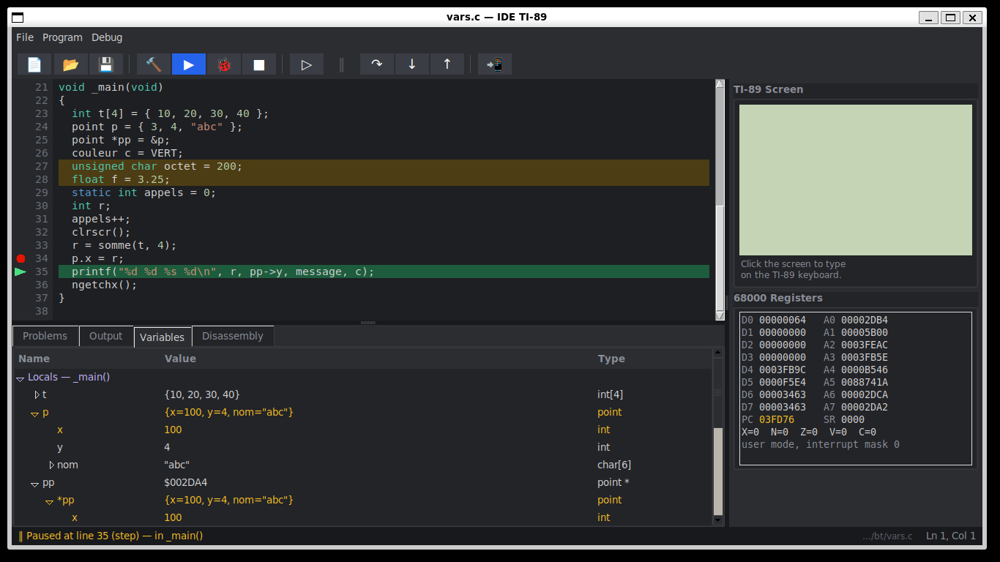
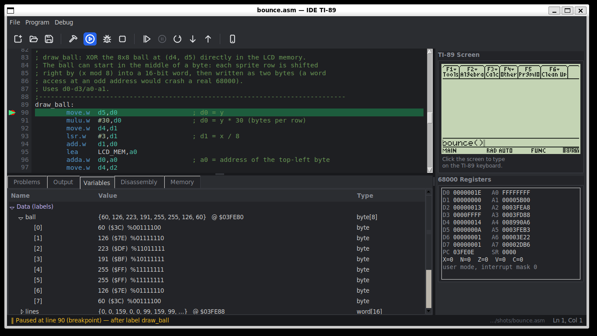
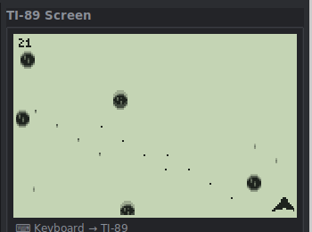

# TI-89 IDE

A small integrated development environment for the **TI-89 Titanium**, running on
Linux / WSL: write a program in **C** or **68000 assembly**, run it in a built-in
emulator, debug it at source level, and send it to the real calculator over USB.



## Features

- **Editor** with syntax highlighting for C, GNU as and A68k assembly, line numbers,
  auto-indent, breakpoints in the margin.
- **Build** with [GCC4TI](https://github.com/debrouxl/gcc4ti) (GCC 4.1.2, C99 mode),
  errors and warnings listed and highlighted in the code. Optimization level for
  Build / Run / Send: speed (`-O2`, default), size (`-Os`) or none (`-O0`), in
  *Program > Optimization* or by clicking the indicator in the status bar; Debug always
  builds with `-O0`.
- **Run** in an emulated TI-89 Titanium: only the calculator screen is shown; your PC
  keyboard types on the calculator (AZERTY or QWERTY, arrows can be held for games).
  Grayscale (4 levels) is rendered correctly.
- **Debugger**
  - breakpoints, Continue, Pause, Step Over, Step Into, Step Out;
  - 68000 registers in hex, unsigned / signed decimal or binary (changed values
    highlighted); click a register for its .b / .w / .l values, binary, ASCII, the
    nearest program label, or the SR flags bit by bit;
  - disassembly annotated with source lines;
  - **C variables** (locals, parameters, globals, statics) with their types: integers,
    chars, enums, TI floats, pointers, strings, arrays, structs;
  - **memory view** (hex dump, follow a register, edit RAM bytes);
  - assembly: step by instruction, step over `jsr`/`bsr` and AMS ROM calls; the
    Variables tab shows labelled data (`dc.b`/`dc.w`/`ds`, `.byte`/`.word`/`.asciz`...)
    read from memory, and the `equ` constants.
- **Send to the real TI-89 Titanium** over the direct USB cable (libticalcs, usbipd on WSL).
- Examples in `projets/exemples/`: graphics, grayscale, and a small sprite game.



## How it works

| Part | Location | Notes |
|---|---|---|
| IDE | `ide89/` | Python / tkinter |
| Emulator | `emu89/` | 68000 CPU: [Musashi](https://github.com/kstenerud/Musashi) (C, git submodule); memory map, I/O ports, flash, timers, keyboard and LCD in Python (`emu89/ti89emu/`), following the *TI hardware guide* by Romain Liévin |
| Debug info | `emu89/ti89emu/dbginfo.py`, `variables.py` | DWARF 2 from `tigcc -g` (.dbg files); A68k listings for `.asm` files |
| Loading programs | `emu89/ti89emu/stubs/loadvar.s` | a tiny 68000 loader calls AMS itself (`SymAdd`, `HeapAlloc`...) to create the program variable |

Programs are run from a snapshot of the emulated calculator taken once AMS has booted,
so every run starts from a clean state.

## Requirements

- Linux or WSL 2 (tested on Ubuntu 24.04 / WSL 2 with WSLg)
- `python3` with `tkinter`, `gcc`, `make`, `git`, `patch`, `bzip2`
- To send programs to a real calculator: the TI link libraries
  (`libticalcs2`, `libticables2`, `libtifiles2`, e.g. installed with the `tiemu` or `tilp2`
  packages) and, on WSL, [usbipd-win](https://github.com/dorssel/usbipd-win)
- **Your own TI-89 Titanium ROM image** (see below)

## Installation

### Ready-to-use Linux package

**[download ti89-ide-linux.tar.gz](https://github.com/JC-Toussaint/ti89-ide/releases/download/linux-v1.0/ti89-ide-linux.tar.gz)**
([release page](https://github.com/JC-Toussaint/ti89-ide/releases/tag/linux-v1.0)):
x86_64, glibc 2.38 or later (Ubuntu 24.04+, Debian 13+, Fedora 39+...). It contains the
IDE, the emulator and GCC4TI, with Python and Tk included:

```sh
tar -xzf ti89-ide-linux.tar.gz
cd ti89-ide-linux
./ti89-ide                  # after putting your ROM in ROM/ (see below)
```

The package is built with `scripts/package_linux.sh`.

### From the sources

```sh
git clone --recurse-submodules https://github.com/JC-Toussaint/ti89-ide.git
cd ti89-ide
scripts/setup.sh            # Python environment (pyelftools, Pillow), Musashi, C core
scripts/build_gcc4ti.sh     # builds the GCC4TI toolchain into ./gcc4ti (10-20 min)
```

### ROM image

The calculator operating system (AMS) is copyrighted by Texas Instruments and is
**not included**. Dump the ROM of your own calculator (for example with TiLP or TiEmu)
and save it as `ROM/ti89tv310.rom` (4 MB, AMS 3.10), or point the `TI89_ROM`
environment variable to it.

## Windows

A native Windows version is available as a zip package:
**[download ti89-ide-windows.zip](https://github.com/JC-Toussaint/ti89-ide/releases/download/windows-v1.0/ti89-ide-windows.zip)**
([release page](https://github.com/JC-Toussaint/ti89-ide/releases/tag/windows-v1.0)).
Unzip it, put your ROM in the
`ROM` folder, and start `ti89-ide.exe` (no Python, no WSL needed). It contains the IDE,
the emulator and a Windows build of GCC4TI whose output is identical, byte for byte, to
the Linux one.

Building the package from Linux / WSL (needs `mingw-w64` and Python 3 for Windows):

```sh
scripts/build_gcc4ti.sh             # Linux toolchain first (its headers and libraries are reused)
scripts/build_gcc4ti_windows.sh     # GCC4TI cross-built for Windows into ./gcc4ti-win
make -C emu89/core windows          # ti89core.dll
scripts/package_windows.sh          # dist-windows/ti89-ide-windows.zip
```

Notes: the Windows toolchain is 32-bit (GCC 4.1.2 crashes as a 64-bit Windows program);
sending to a real calculator on Windows uses TiLP for Windows and its USB driver.

## Usage

```sh
./run-ide.sh [program.c | program.s | program.asm]
```

| Action | Key |
|---|---|
| Build | F7 |
| Run in the emulator / Continue | F5 |
| Debug | F6 |
| Toggle breakpoint | F9 or click in the margin |
| Step Over / Into / Out | F10 / F11 / Shift+F11 |
| Stop | Shift+F5 |
| Send to the TI-89 (USB) | Ctrl+T |

Click the calculator screen to type on the TI-89 keyboard; click the editor to get the
keyboard back. Program names must follow TI-89 rules (8 characters max., not a
built-in command name such as `graph`).

### Sending to a real calculator from WSL

Once, with the calculator plugged in and turned on:

1. in an **administrator** PowerShell: `usbipd bind --hardware-id 0451:e004`
2. in WSL, allow your user to access the device:
   ```sh
   echo 'SUBSYSTEM=="usb", ATTR{idVendor}=="0451", ATTR{idProduct}=="e004", MODE="0666"' \
     | sudo tee /etc/udev/rules.d/70-ti89titanium.rules
   sudo udevadm control --reload-rules && sudo udevadm trigger
   ```

The IDE then attaches the calculator to WSL by itself (`usbipd attach`) when you send a program.

## Example game



`projets/exemples/meteor.c`: dodge the falling meteors. Shows sprites, double buffering,
direct keyboard reading and a steady frame rate driven by the 256 Hz interrupt.

## Credits

- [Musashi](https://github.com/kstenerud/Musashi) 68000 emulator core, by Karl Stenerud (MIT)
- [GCC4TI](https://github.com/debrouxl/gcc4ti) / TIGCC toolchain and library
- *TI hardware guide* (TiEmu documentation) by Romain Liévin

## License

MIT, see [LICENSE](LICENSE). Musashi keeps its own license.
